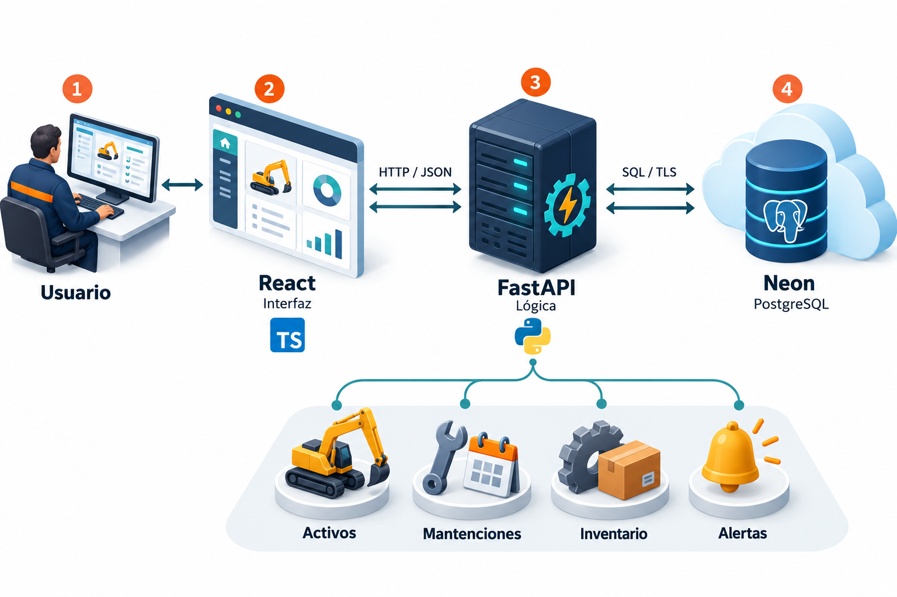
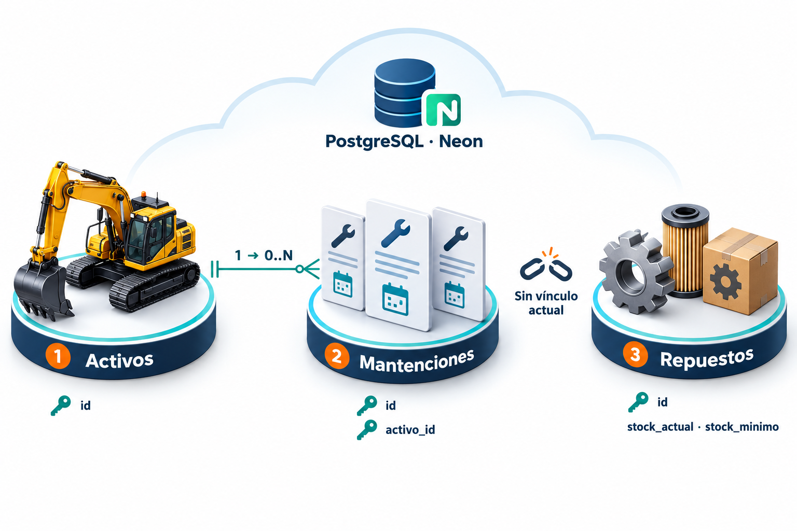
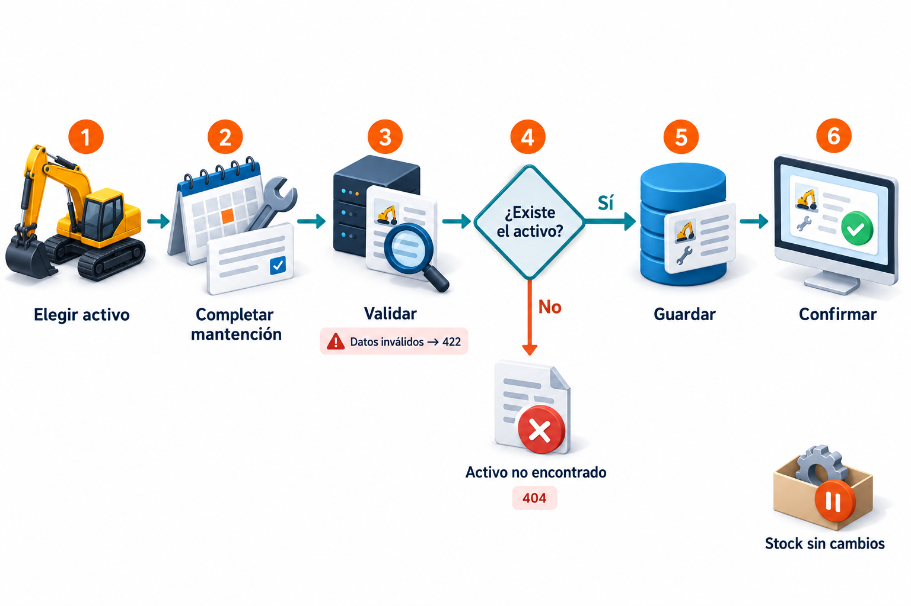
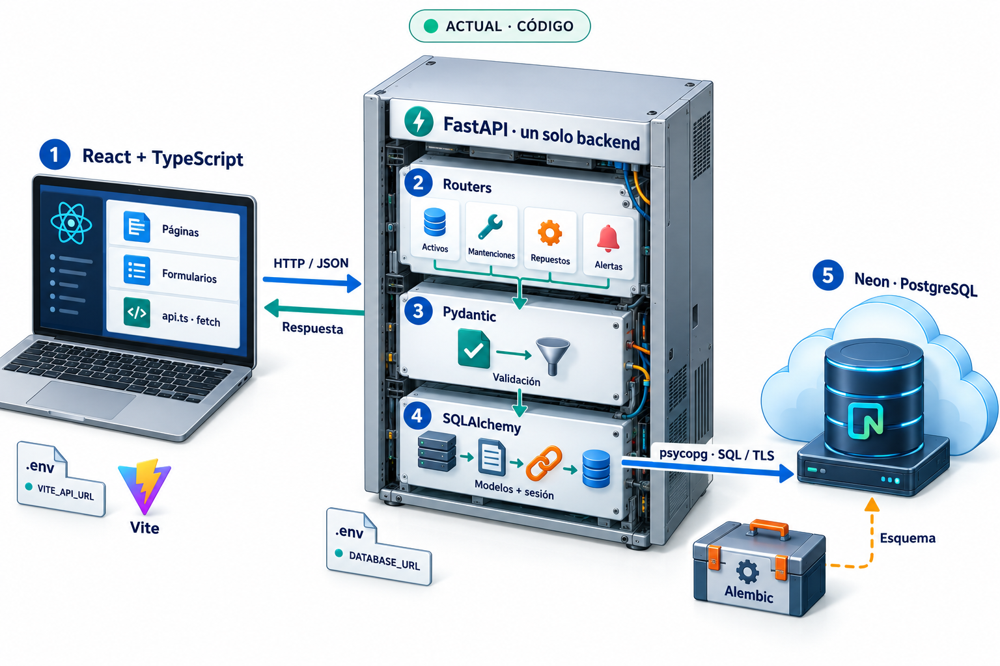
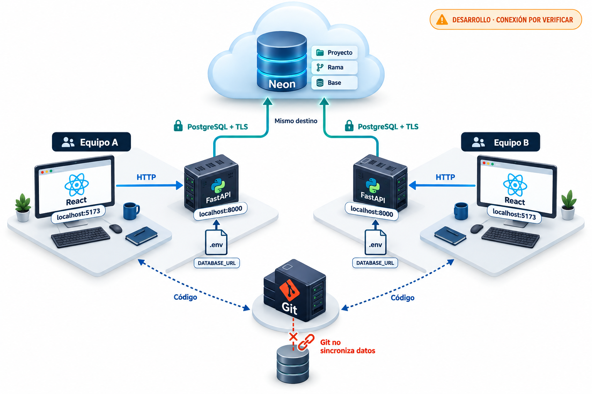
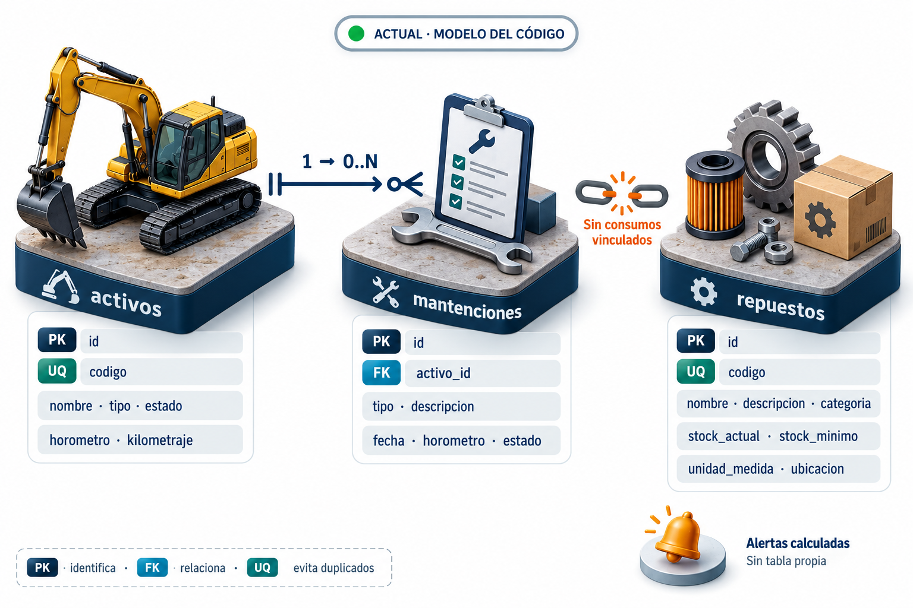
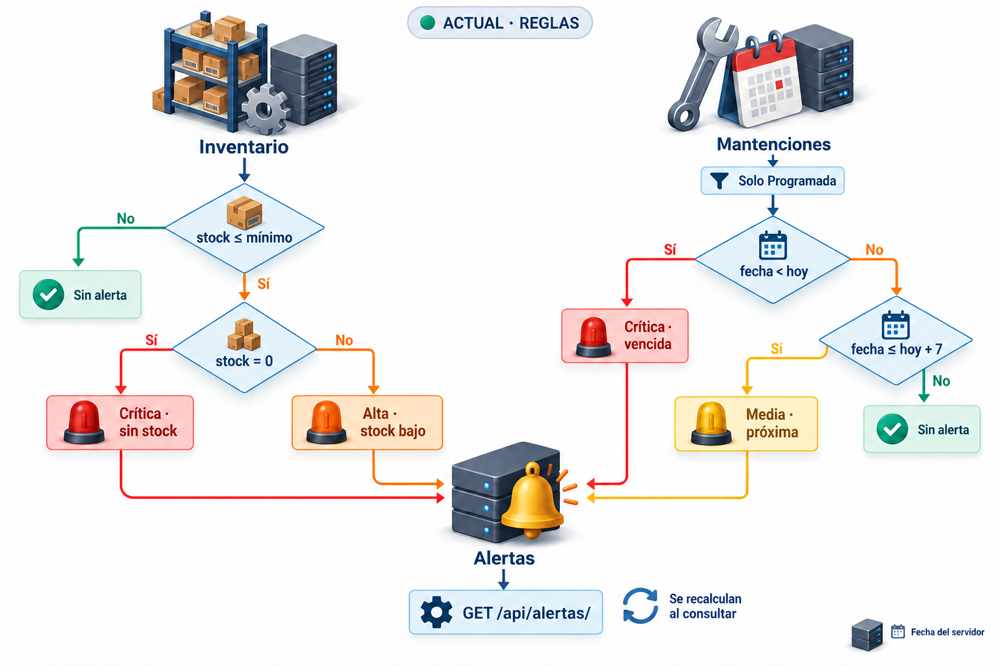
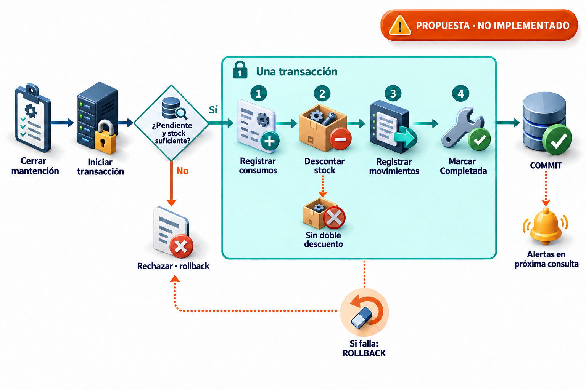
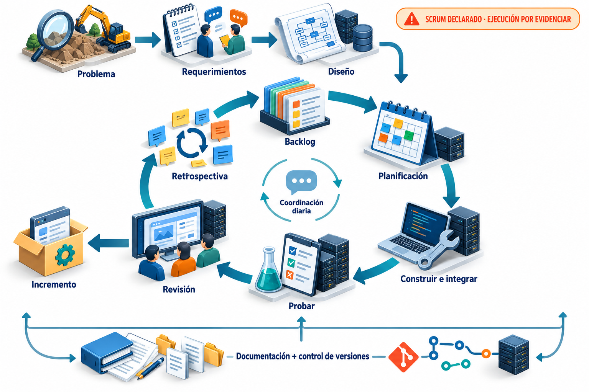
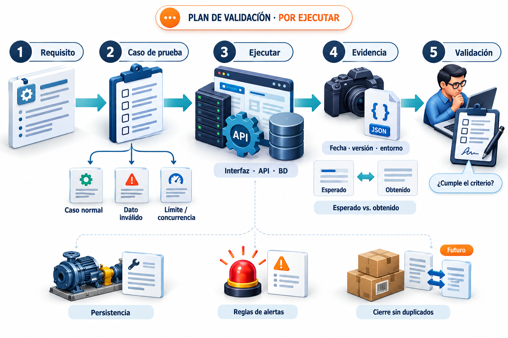

# Hydra-One · Guía de la colección visual ampliada

Revisión documental y del repositorio: 28 de octubre de 2026. Diez mapas PNG: tres introductorios y siete de profundización. Las imágenes se elaboraron con la herramienta integrada de generación de imágenes; los prompts de las siete nuevas están en catalogo-ampliado.json.

## Orden recomendado

Para explicar a público general: 01 → 02 → 03. Para revisión técnica: 04 → 05 → 06 → 07. Para alcance pendiente y proceso de trabajo: 08 → 09 → 10. Cada mapa tiene una función; no hace falta mostrarlos todos al responder una pregunta.

## Qué demuestra esta colección

Documenta un modelo explicativo del código y del enfoque declarado. No acredita que la conexión a Neon funcione, que se hayan ejecutado pruebas ni que se haya aplicado Scrum de manera completa. Las interfaces y servidores dibujados son metáforas visuales. Los PNG no contienen elementos editables; los anteriores draw.io siguen disponibles como complemento técnico.

## 01. Vista general del sistema

Estado: **Introducción**.

### Cómo leerlo

El usuario interactúa con React; FastAPI procesa las solicitudes y PostgreSQL conserva los registros. Los cuatro iconos inferiores son módulos del mismo backend.

### Ejemplo para explicarlo

La pantalla pide, el backend procesa y la base de datos conserva.

## 02. Relaciones en una mirada

Estado: **Introducción**.

### Cómo leerlo

Un activo puede tener cero o muchas mantenciones. Los repuestos todavía no están vinculados al consumo de una mantención.

### Ejemplo para explicarlo

Las tarjetas representan varios registros posibles, no una cantidad fija de tres.

## 03. Registrar una mantención

Estado: **Actual · recorrido resumido**.

### Cómo leerlo

Se elige un activo, se rellena el formulario, se validan los datos y se comprueba la existencia del activo antes de guardar. Datos inválidos pueden producir 422; activo inexistente, 404; alta correcta, 201.

### Ejemplo para explicarlo

Completar el formulario no significa cerrar una mantención. El stock permanece igual.

## 04. Arquitectura interna

Estado: **Actual · lectura del código**.

### Cómo leerlo

Lee el navegador, los módulos del backend y la base de datos. api.ts envía solicitudes; Pydantic valida estructuras; los routers implementan operaciones; SQLAlchemy gestiona modelos y sesiones; psycopg comunica con PostgreSQL. Alembic modifica el esquema mediante migraciones.

### Ejemplo para explicarlo

Al crear una mantención, el formulario envía JSON, se valida la entrada, el router comprueba el activo y guarda el registro. Alembic no se ejecuta por cada solicitud.

### Pregunta de defensa

¿Por qué usar un monolito modular? Los módulos comparten un backend y una base, lo que mantiene acotada la operación del MVP. El costo es que la lógica actual está directamente en los routers.

### Alcance y límites

Las estanterías representan responsabilidades, no un orden exacto de llamadas: FastAPI valida la entrada antes de ejecutar el cuerpo del router. Pydantic no consulta la base. Las respuestas también se serializan. No hay autenticación ni roles implementados. El servidor es una metáfora del proceso, y Neon no se verificó en vivo.

### Fuentes

frontend/src/services/api.ts; frontend/src/App.tsx; backend/main.py; backend/app/routers/; backend/app/schemas/; backend/app/database/connection.py; backend/alembic/.

## 05. Desarrollo compartido y Neon

Estado: **Configuración prevista · conexión remota sin verificar**.

### Cómo leerlo

Cada integrante ejecuta su frontend y backend local. localhost siempre significa su propia máquina. Cada backend lee DATABASE_URL y debe apuntar al destino acordado en Neon. Git distribuye versiones del código; los registros se comparten mediante la base de datos.

### Ejemplo para explicarlo

Ambos integrantes pueden tener el mismo commit y aun ver datos diferentes si sus conexiones apuntan a ramas o bases distintas. VITE_API_URL indica a qué API llama la interfaz; DATABASE_URL indica a qué base se conecta esa API.

### Pregunta de defensa

¿Por qué dos procesos locales? Vite sirve la interfaz durante el desarrollo; Uvicorn ejecuta la API Python. Separarlos permite desarrollar y diagnosticar ambas partes.

### Alcance y límites

El dibujo describe la configuración prevista y los valores locales habituales, no conexiones verificadas ni un despliegue productivo. Compartir destino no garantiza iguales permisos de lectura. Los candados representan TLS, no permisos de usuario de Hydra-One. La rama de Neon y una rama Git son cosas distintas.

### Fuentes

backend/app/database/connection.py; backend/main.py; frontend/src/services/api.ts; conexión Neon proporcionada por el equipo, sin reutilizar ni publicar secretos.

## 06. Datos y relaciones esenciales

Estado: **Actual · modelo del repositorio**.

### Cómo leerlo

Las tres plataformas corresponden a tablas. PK identifica cada fila; UQ impide repetir el código dentro de su tabla; FK activo_id relaciona la mantención con un activo. La cardinalidad 1 → 0..N permite varios trabajos por equipo. Repuestos no tiene relación de consumo con mantenciones.

### Ejemplo para explicarlo

El activo con id 12 puede tener mantenciones con ids 31 y 45; ambas guardan activo_id=12. Son identificadores de ejemplo, no datos extraídos de Neon.

### Pregunta de defensa

¿Por qué no existe una tabla de alertas? El código calcula la lista a partir de stock, fechas y estados cuando se consulta. Persistir un historial de alertas sería otra funcionalidad.

### Alcance y límites

Los campos se agrupan para facilitar la lectura; no son columnas compuestas. Todos los campos actuales son NOT NULL. La imagen no incluye tipos, índices ni todas las restricciones: para ese detalle consultar ../svg/04-erd-actual.svg. El esquema remoto puede diferir si no se aplicaron las migraciones.

### Fuentes

backend/app/models/activo.py; mantencion.py; repuesto.py; backend/alembic/versions/; backend/app/routers/alertas.py.

## 07. Cómo se generan las alertas

Estado: **Actual · reglas del backend**.

### Cómo leerlo

Sigue cada rombo por Sí o No. Inventario compara stock_actual con stock_minimo; solo si el umbral se cumple distingue cero de stock bajo. Mantenciones considera únicamente estado Programada y compara fecha con hoy y hoy+7. Solo las ramas con alerta aportan elementos a la respuesta.

### Ejemplo para explicarlo

Stock 0 y mínimo 3 produce Crítica; stock 2 y mínimo 3 produce Alta; stock 4 no produce alerta. Para una mantención Programada, ayer es vencida, hoy y el séptimo día son próximas, el octavo día queda fuera.

### Pregunta de defensa

¿Las alertas se envían solas? No. Se recalculan al solicitar GET /api/alertas/. La fecha usada es la del servidor.

### Alcance y límites

El recorrido visual representa reglas y composición de la respuesta; la petición GET desencadena el cálculo aunque su rótulo aparezca abajo. No representa tareas concurrentes, correo ni almacenamiento de alertas. Cambiar a Completada excluye la mantención de esta consulta, pero no registra un historial de notificaciones.

### Fuentes

backend/app/routers/alertas.py; backend/app/schemas/alerta.py.

## 08. Cierre e inventario integrados

Estado: **Propuesta · pendiente de implementar**.

### Cómo leerlo

El cierre propuesto valida que la mantención sea cerrable y que las cantidades y existencias sean válidas. Consumos, descuento, movimientos y estado deben confirmarse juntos con COMMIT. Un fallo durante la transacción exige ROLLBACK. Las alertas se recalcularían en una consulta posterior.

### Ejemplo para explicarlo

Ejemplo propuesto: stock inicial 5 y consumo 2 dejan 3 unidades y una salida registrada. Si falla el registro del movimiento, no deberían persistir ni el descuento ni el cierre. Repetir la solicitud no debe descontar otras 2 unidades.

### Pregunta de defensa

¿Cómo evitar el doble descuento? Diseñar una operación de cierre con control de concurrencia, bloqueo de los registros necesarios y restricciones de unicidad o idempotencia. Una comprobación aislada del stock no basta.

### Alcance y límites

Este flujo NO está implementado. Actualmente actualizar una mantención solo guarda sus campos y estado. Antes de desarrollar, acordar unidades enteras o fraccionarias, política de anulaciones, permisos y borrados. Un fallo al consultar alertas después de COMMIT no revierte el cierre confirmado. Los candados representan control transaccional, no autenticación.

### Fuentes

Propuesta derivada de backend/app/routers/mantenciones.py y de la ausencia de consumos/movimientos en los modelos; complementa ../svg/08-erd-propuesto.svg y ../svg/09-cierre-propuesto.svg.

## 09. Metodología y ciclo de trabajo

Estado: **Enfoque declarado · ejecución por respaldar**.

### Cómo leerlo

El informe declara un enfoque de ingeniería apoyado en Scrum. El dibujo conecta problema, requerimientos y diseño con planificación, construcción, pruebas, revisión y mejora. Documentación y control de versiones acompañan todo el trabajo.

### Ejemplo para explicarlo

Una tarea podría ser: como encargado, consultar las mantenciones de un activo. Se acuerda un criterio verificable, se implementa, se prueba y se revisa el resultado; las observaciones alimentan nuevas tareas.

### Pregunta de defensa

¿Cómo demostrar que utilizaron ese enfoque? Con backlog priorizado, objetivos de iteración, tareas con responsables, versiones, evidencias de revisión y acuerdos de mejora. Nombrar Scrum o mostrar el diagrama no demuestra su ejecución.

### Alcance y límites

Es una adaptación didáctica del enfoque declarado, no un diagrama normativo completo de Scrum. No acredita ceremonias realizadas, duración de sprints ni roles asignados. Diseño, construcción y pruebas pueden repetirse durante el desarrollo; no son fases rígidas. El incremento se construye durante el trabajo, no nace únicamente en la reunión de revisión.

### Fuentes

Fase 1/Evidencias Grupales/Informe Técnico.docx, sección 9; Fase 2/Evidencias Grupales/2.4_GuiaEstudiante_Fase 2_DesarrolloProyecto APT.docx, Metodología; informe 2.6 de fase 2.

## 10. Validación y respaldo del proyecto

Estado: **Plan recomendado · no resultados ejecutados**.

### Cómo leerlo

Cada requisito debe vincularse a un caso reproducible. Se ejecuta sobre interfaz, API o base según corresponda, se conserva la evidencia y se compara lo esperado con lo obtenido. La revisión decide si satisface el criterio.

### Ejemplo para explicarlo

Requisito: asociar una mantención con un activo existente. Caso: crearla con un activo de prueba. Evidencia: solicitud y respuesta, registro guardado y consulta del historial con el mismo identificador. Caso negativo: un activo inexistente debe producir 404 sin crear una mantención.

### Pregunta de defensa

¿Qué hace convincente una evidencia? Que otra persona pueda reproducirla: precondiciones, pasos, resultado esperado y real, fecha, versión y entorno. Una captura aislada no demuestra el recorrido completo.

### Alcance y límites

Es un plan recomendado, no un reporte de pruebas ejecutadas. El cierre sin duplicados se marca Futuro porque esa operación no existe aún. No se inventaron resultados, tiempos, porcentajes ni aprobaciones. La firma del icono es ilustrativa.

### Fuentes

docs/anexos/RESPALDOS-PENDIENTES.md; rutas y reglas actuales de backend/app/routers/; alcance y metodología de los informes.

## Criterios para acompañar las imágenes con evidencias

- Documentación: requisito y decisión vinculados con la versión del diagrama.
- Aplicación: recorrido reproducible, capturas reales, respuestas HTTP y resultado observado.
- Base de datos: esquema real, migración aplicada y consulta del mismo registro usado en la demostración.
- Metodología: backlog, objetivos, responsables, acuerdos y revisiones fechadas.
- Pruebas: esperado frente a obtenido, versión, entorno y defectos encontrados.

## Revisión de las imágenes

Se revisaron las etiquetas, las relaciones y el sentido de las flechas. Se corrigieron dos conexiones generadas: «sin alerta» no aporta una alerta a la lista; y una consulta posterior a COMMIT no dispara rollback del cierre ya confirmado. Las imágenes finales incluidas contienen esas correcciones. La revisión de archivos comprueba PNG y enlaces locales; no son pruebas de Hydra-One.

## Ediciones de generación

07: eliminar la conexión de salida de «Sin alerta» hacia la campana central.

08: eliminar la conexión desde «Alertas en próxima consulta» hacia ROLLBACK; conservar rollback solo para errores durante la transacción.

## Archivos

coleccion.html / index.html: galería local sin dependencias externas.

01–10: imágenes PNG.

catalogo-ampliado.json: explicación estructurada, estado, fuentes y prompts de generación.

crear_coleccion.py: regenera la galería y esta guía sin modificar imágenes.

LEEME.md: explicación original de los tres primeros mapas.
